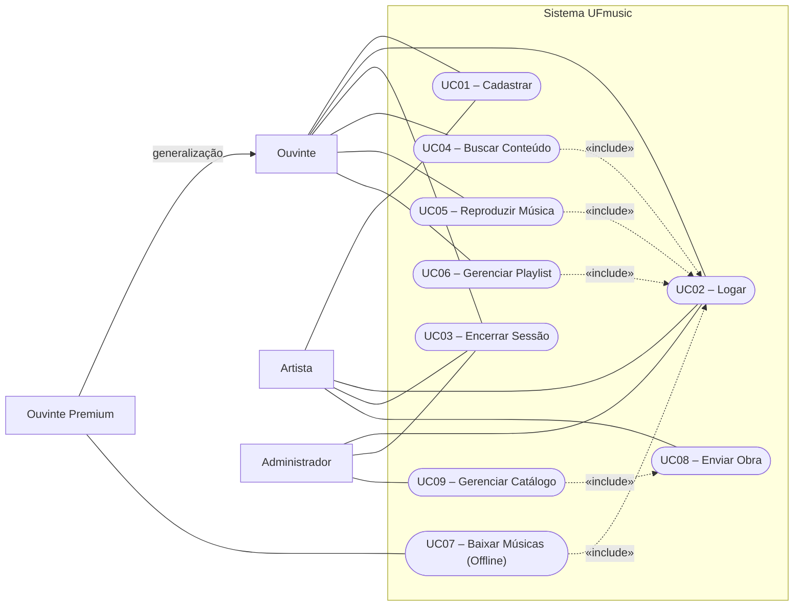
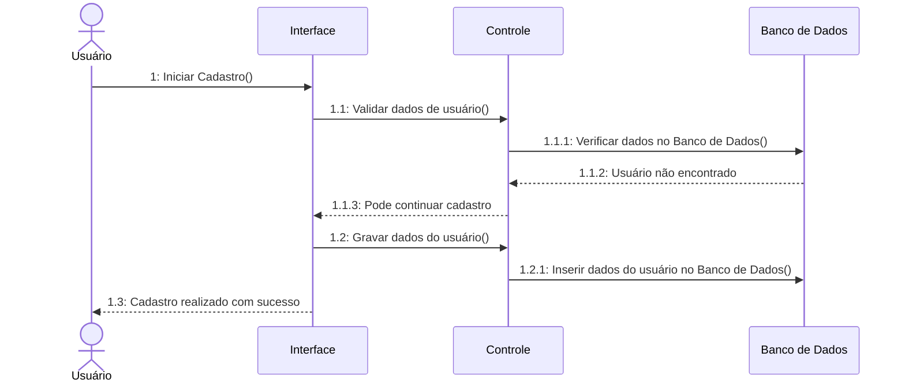
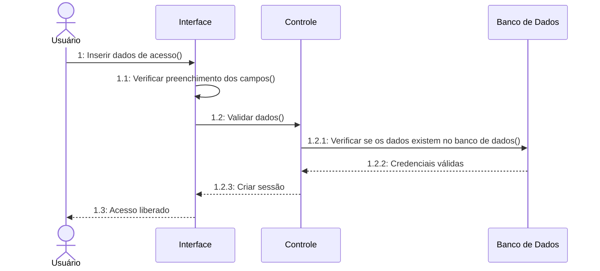
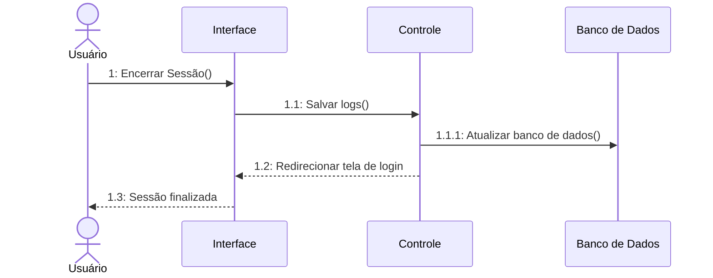
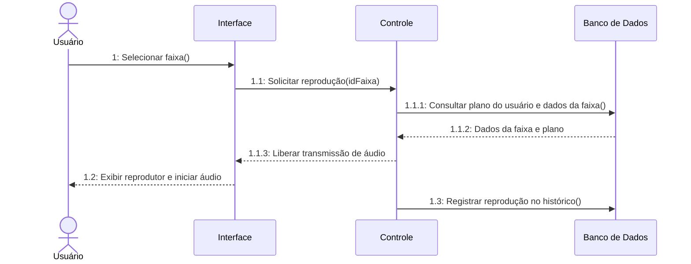
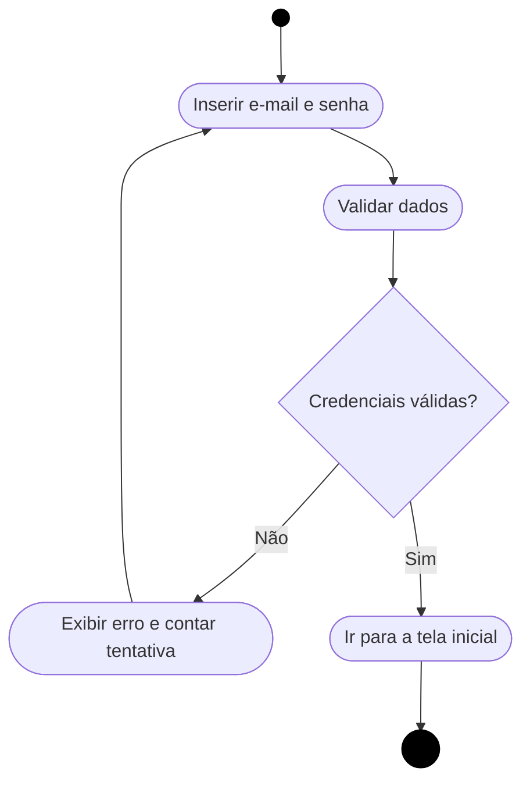
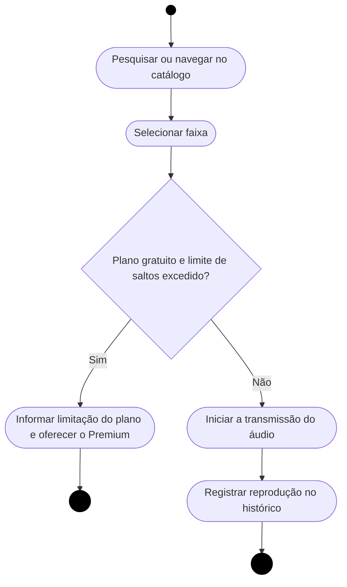

# UFmusic

**Documento de Requisitos de Software**

Universidade Federal do Amazonas – UFAM · Instituto de Ciências Exatas e Tecnologia – ICET · Engenharia de Software · Itacoatiara/AM · 2026

**Equipe:** Felipe Gabriel dos Santos Silva · Jorge Victor Lima de Oliveira

---

## Sumário

1. [Introdução](#1-introdução)
   - 1.1. [Descrição Geral do Software](#11-descrição-geral-do-software)
   - 1.2. [Descrição dos Usuários](#12-descrição-dos-usuários)
2. [Requisitos Gerais do Software](#2-requisitos-gerais-do-software)
   - 2.1. [Requisitos Funcionais](#21-requisitos-funcionais)
   - 2.2. [Requisitos Não Funcionais](#22-requisitos-não-funcionais)
   - 2.3. [Regras de Negócio](#23-regras-de-negócio)
3. [Diagramas UML](#3-diagramas-uml)
   - 3.1. [Diagramas de Casos de Uso](#31-diagramas-de-casos-de-uso)
   - 3.2. [Diagramas de Sequência](#32-diagramas-de-sequência)
   - 3.3. [Diagramas de Atividades](#33-diagramas-de-atividades)

---

## 1. Introdução

### 1.1. Descrição Geral do Software

O **UFmusic** é uma plataforma de streaming de música, de funcionamento semelhante ao de serviços consagrados como o Spotify, concebida inicialmente para a comunidade acadêmica da Universidade Federal do Amazonas (UFAM). O sistema permite que os usuários pesquisem, reproduzam e organizem músicas em playlists, descubram novos conteúdos por meio de recomendações personalizadas e, na modalidade Premium, reproduzam faixas sem conexão com a internet. Adicionalmente, oferece espaço para a divulgação de artistas, inclusive de produções musicais regionais e universitárias.

**O que o sistema faz:**
- gerencia contas de usuários;
- disponibiliza catálogo musical pesquisável;
- reproduz áudio por streaming;
- permite criação, edição e compartilhamento de playlists;
- mantém biblioteca de músicas curtidas e histórico de reprodução;
- recomenda conteúdo;
- gerencia planos de assinatura;
- permite a administração do catálogo.

**O que o sistema não faz:**
- não comercializa arquivos de áudio de forma definitiva;
- não permite a extração ou redistribuição de arquivos fora do aplicativo;
- não realiza transmissão de vídeo;
- não oferece funcionalidades de rede social além do compartilhamento de playlists e do ato de seguir artistas.

### 1.2. Descrição dos Usuários

| Usuário | Descrição |
|---|---|
| **Ouvintes** | Membros da comunidade acadêmica ou público em geral que desejam ouvir músicas, organizar playlists e descobrir novos conteúdos. Subdividem-se em usuários do **Plano Gratuito** e do **Plano Premium**. |
| **Artistas** | Usuários que possuem perfil de artista e desejam divulgar suas obras na plataforma, por meio de solicitação ao administrador. |
| **Administradores** | Responsáveis pela gestão do catálogo, pela moderação de conteúdo e pela manutenção das contas de usuários. |

---

## 2. Requisitos Gerais do Software

> **Prioridade:** *Essencial* (indispensável ao funcionamento), *Importante* (agrega valor significativo) e *Desejável* (pode ser adiada sem prejuízo ao núcleo do sistema).

### 2.1. Requisitos Funcionais

| ID | Nome | Descrição | Prioridade | Ator |
|---|---|---|---|---|
| RF01 | Cadastrar usuário | O sistema deve permitir que um visitante crie uma conta informando e-mail, senha e categoria de usuário. | Essencial | Visitante |
| RF02 | Realizar login | O sistema deve autenticar o usuário mediante e-mail e senha válidos. | Essencial | Usuário |
| RF03 | Encerrar sessão | O sistema deve permitir que o usuário encerre sua sessão e seja redirecionado à tela de login. | Essencial | Usuário |
| RF04 | Recuperar senha | O sistema deve permitir a redefinição de senha por meio de link enviado ao e-mail cadastrado. | Importante | Usuário |
| RF05 | Gerenciar perfil | O sistema deve permitir a edição de nome, foto e preferências musicais do usuário. | Importante | Usuário |
| RF06 | Buscar conteúdo | O sistema deve permitir a busca de faixas, álbuns, artistas e playlists por palavras-chave. | Essencial | Ouvinte |
| RF07 | Reproduzir música | O sistema deve reproduzir faixas por streaming, com controles de reproduzir, pausar, avançar, retornar, ajustar volume e posicionar a faixa. | Essencial | Ouvinte |
| RF08 | Gerenciar fila de reprodução | O sistema deve permitir adicionar, remover e reordenar faixas na fila de reprodução. | Importante | Ouvinte |
| RF09 | Gerenciar playlists | O sistema deve permitir criar, renomear, excluir playlists e adicionar ou remover faixas. | Essencial | Ouvinte |
| RF10 | Curtir músicas | O sistema deve permitir marcar faixas como curtidas e consultá-las na biblioteca pessoal. | Importante | Ouvinte |
| RF11 | Compartilhar playlists | O sistema deve permitir tornar uma playlist pública e compartilhá-la por link. | Desejável | Ouvinte |
| RF12 | Consultar histórico | O sistema deve registrar e exibir o histórico de faixas reproduzidas. | Desejável | Ouvinte |
| RF13 | Seguir artistas | O sistema deve permitir seguir artistas e exibir seus lançamentos. | Desejável | Ouvinte |
| RF14 | Recomendar conteúdo | O sistema deve sugerir faixas e playlists com base no histórico e nas preferências do usuário. | Importante | Sistema |
| RF15 | Baixar músicas para uso offline | O sistema deve permitir o download de faixas para reprodução sem conexão, exclusivamente no Plano Premium. | Importante | Ouvinte Premium |
| RF16 | Gerenciar plano de assinatura | O sistema deve permitir contratar, alterar e cancelar o Plano Premium. | Importante | Ouvinte |
| RF17 | Gerenciar catálogo | O sistema deve permitir ao administrador cadastrar, editar e remover faixas, álbuns e artistas. | Essencial | Administrador |
| RF18 | Publicar obras de artista | O sistema deve permitir que o artista envie suas faixas para análise e publicação pelo administrador. | Desejável | Artista |

### 2.2. Requisitos Não Funcionais

| ID | Categoria | Descrição | Prioridade |
|---|---|---|---|
| RNF01 | Desempenho | A reprodução de uma faixa deve iniciar em até 3 segundos após a solicitação, em conexão de, no mínimo, 5 Mbps. | Essencial |
| RNF02 | Desempenho | Os resultados de busca devem ser exibidos em até 2 segundos. | Importante |
| RNF03 | Disponibilidade | O sistema deve estar disponível em, no mínimo, 99% do tempo mensal. | Importante |
| RNF04 | Segurança | As senhas devem ser armazenadas de forma criptografada, com algoritmo de hash seguro (por exemplo, bcrypt). | Essencial |
| RNF05 | Segurança | Toda comunicação entre cliente e servidor deve utilizar o protocolo HTTPS/TLS. | Essencial |
| RNF06 | Conformidade legal | O tratamento de dados pessoais deve atender à LGPD, com registro de consentimento do usuário. | Essencial |
| RNF07 | Usabilidade | A interface deve ser intuitiva, de modo que um usuário novo consiga reproduzir uma música em até 3 interações após o login. | Importante |
| RNF08 | Compatibilidade | O sistema deve funcionar nos navegadores Chrome, Firefox e Edge (versões recentes) e em dispositivos Android. | Importante |
| RNF09 | Escalabilidade | A arquitetura deve suportar, no mínimo, 1.000 usuários simultâneos sem degradação perceptível. | Importante |
| RNF10 | Confiabilidade | Em caso de queda de conexão, o sistema deve armazenar em buffer e retomar a reprodução automaticamente quando a conexão for restabelecida. | Desejável |
| RNF11 | Qualidade de áudio | O sistema deve oferecer, no mínimo, dois níveis de qualidade (normal: 128 kbps; alta: 320 kbps, exclusiva do Premium). | Desejável |
| RNF12 | Manutenibilidade | O código-fonte deve seguir padrões de codificação documentados e possuir cobertura de testes unitários de, no mínimo, 70%. | Desejável |

### 2.3. Regras de Negócio

| ID | Regra | Descrição | Relacionados |
|---|---|---|---|
| RN01 | Unicidade de e-mail | Cada e-mail pode estar associado a uma única conta no sistema. | RF01 |
| RN02 | Política de senha | A senha deve conter no mínimo 8 caracteres, incluindo letras e números. | RF01, RF04 |
| RN03 | Bloqueio por tentativas | Após 5 tentativas consecutivas de login inválidas, a conta é bloqueada temporariamente por 15 minutos. | RF02 |
| RN04 | Expiração de sessão | A sessão expira após 30 dias de inatividade, exigindo novo login. | RF02, RF03 |
| RN05 | Limitação do plano gratuito | Usuários do Plano Gratuito possuem limite de 6 saltos de faixa por hora e não têm acesso a download. | RF07, RF15 |
| RN06 | Exclusividade do download | O download de faixas é permitido apenas a assinantes Premium com assinatura ativa; ao término da assinatura, os arquivos offline são invalidados. | RF15, RF16 |
| RN07 | Propriedade de playlist | Somente o criador de uma playlist pode editá-la ou excluí-la. | RF09 |
| RN08 | Limite de playlist | Cada playlist pode conter no máximo 10.000 faixas. | RF09 |
| RN09 | Direitos autorais | Somente conteúdo com licença ou autorização do detentor dos direitos pode ser publicado no catálogo. | RF17, RF18 |
| RN10 | Publicação de conteúdo | Obras enviadas por artistas somente são disponibilizadas após aprovação do administrador. | RF18 |
| RN11 | Retenção de histórico | O histórico de reprodução é mantido por 90 dias e pode ser apagado a qualquer momento pelo usuário. | RF12 |
| RN12 | Cancelamento de assinatura | O cancelamento do Plano Premium mantém os benefícios até o fim do período já pago. | RF16 |

---

## 3. Diagramas UML

> Os diagramas abaixo foram escritos em **[Mermaid](https://mermaid.js.org/)**, que o GitHub renderiza automaticamente dentro do `README.md`. Para editar um diagrama, basta alterar o bloco de código correspondente.

### 3.1. Diagramas de Casos de Uso

O diagrama é composto pelos atores **Ouvinte**, **Ouvinte Premium** (especialização de Ouvinte), **Artista** e **Administrador**.

**Associações entre atores e casos de uso**

| Caso de uso | Ouvinte | Ouvinte Premium | Artista | Administrador |
|---|:-:|:-:|:-:|:-:|
| UC01 – Cadastrar | ● | ● | ● | |
| UC02 – Logar | ● | ● | ● | ● |
| UC03 – Encerrar Sessão | ● | ● | ● | ● |
| UC04 – Buscar Conteúdo | ● | ● | | |
| UC05 – Reproduzir Música | ● | ● | | |
| UC06 – Gerenciar Playlist | ● | ● | | |
| UC07 – Baixar Músicas (Offline) | | ● | | |
| UC08 – Enviar Obra | | | ● | |
| UC09 – Gerenciar Catálogo | | | | ● |

**Relacionamentos entre casos de uso:** UC04, UC05, UC06 e UC07 possuem relacionamento de inclusão (`include`) com UC02 – Logar, pois exigem usuário autenticado; UC09 inclui a aprovação de obras enviadas em UC08.

### 3.2. Diagramas de Sequência

Os diagramas seguem o padrão **Boundary–Control–Entity**, envolvendo os participantes Usuário (ator), Interface (*boundary*), Controle (*control*) e Banco de Dados (*entity*).

#### 3.2.1. Cadastrar

#### 3.2.2. Logar

#### 3.2.3. Encerrar Sessão

#### 3.2.4. Reproduzir Música

### 3.3. Diagramas de Atividades

#### 3.3.1. Autenticação do usuário (Login)

| Passo | Elemento | Descrição |
|---|---|---|
| 1 | Nó inicial | Início do fluxo. |
| 2 | Ação | Inserir e-mail e senha. |
| 3 | Ação | Validar dados. |
| 4 | Decisão | Credenciais válidas? |
| 4a | Fluxo "Não" | Exibir mensagem de erro, contabilizar a tentativa e voltar à tela de login (retorna ao passo 2). |
| 4b | Fluxo "Sim" | Criar sessão e ir para a tela inicial. |
| 5 | Nó final | Fim do fluxo. |

#### 3.3.2. Reprodução de música

| Passo | Elemento | Descrição |
|---|---|---|
| 1 | Nó inicial | Início do fluxo. |
| 2 | Ação | Pesquisar ou navegar pelo catálogo. |
| 3 | Ação | Selecionar faixa. |
| 4 | Decisão | Plano Gratuito e limite de saltos excedido? |
| 4a | Fluxo "Sim" | Informar a limitação do plano e oferecer o Premium; fim do fluxo. |
| 4b | Fluxo "Não" | Iniciar a transmissão do áudio. |
| 5 | Ação | Registrar reprodução no histórico. |
| 6 | Nó final | Fim do fluxo. |
